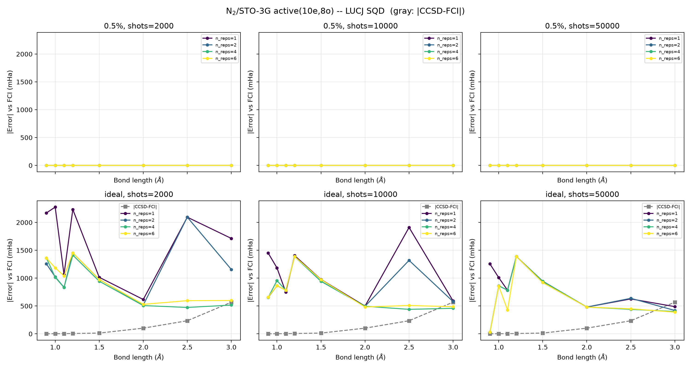
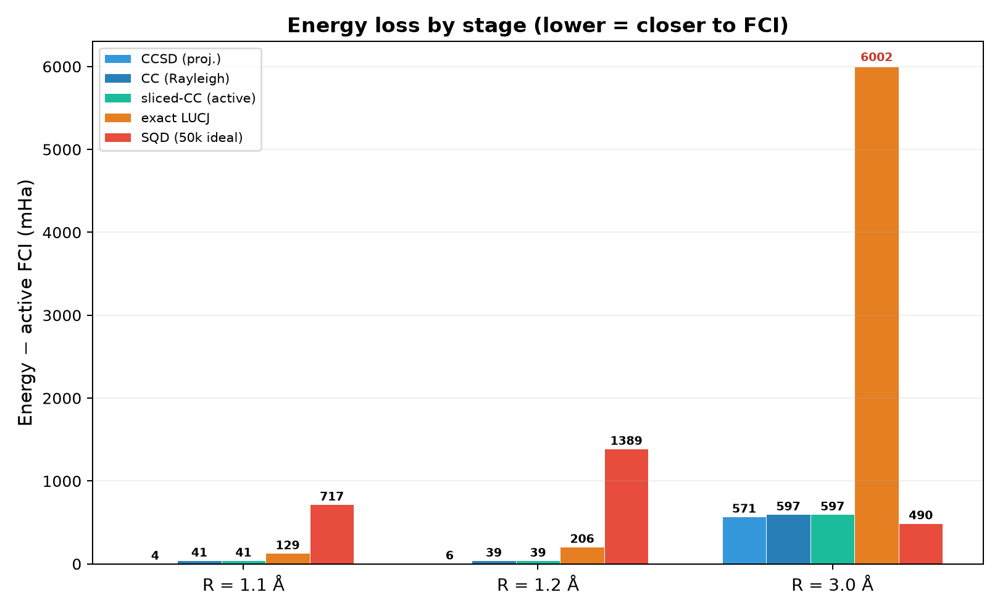
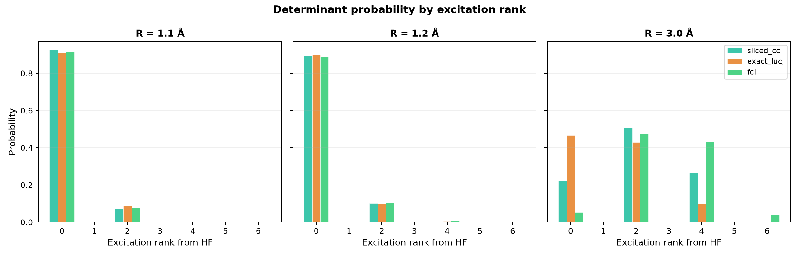
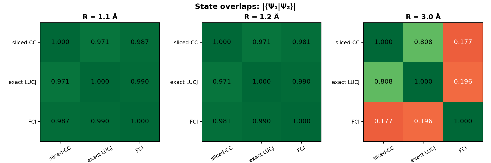
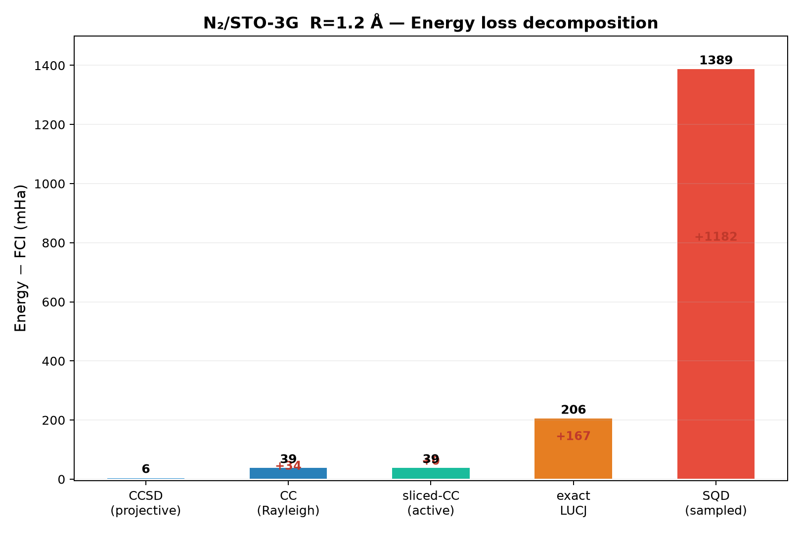

# LUCJ 特性分析：从参数形成到 SQD 后处理

> **摘要**  
> 本文以 N₂/STO-3G 解离曲线为例，追踪 LUCJ 态制备从 CCSD 振幅到 SQD 后处理的完整数据流。核心发现：(1) LUCJ 是 CCSD t₂ 振幅的酉重包装，不是变分优化产物；(2) 平衡区 SQD 误差主因是 LUCJ 采样分布过于集中，导致有限 shots 遗漏大量低权重但合计重要的 determinants；(3) 解离区 SQD 能量优于 sliced-CC 是因为单参考 CCSD 在此处根本不存在收敛解——SQD 的多行列式对角化"意外"地实现了部分多参考恢复。冻结核切片严密等价于投影（overlap ≡ 1），当前 orbital selection 逻辑没有问题。  
> **系统**：N₂/STO-3G，active(10e, 8o)，LUCJ `n_reps=6`，SQD 50k shots ideal。

---

## 1. LUCJ 的参数从哪里来

LUCJ 的 ansatz 形式是 [^1]

\[
\prod_{k=1}^{L} \mathcal{U}_k \, e^{i\mathcal{J}_k} \, \mathcal{U}_k^\dagger
\]

其中 \(\mathcal{U}_k\) 是轨道旋转，\(\mathcal{J}_k\) 是对角的 number-number 算符。形式上像一个 unitary coupled cluster 的 Trotter 步，但参数来源完全不同。

**LUCJ 不通过变分优化，也不通过 Trotter 化 \(e^{T-T^\dagger}\) 获得参数。**  
实际流程是 [^2]：

1. PySCF 跑全空间 RHF + CCSD，得到 \(t_1, t_2\) 振幅
2. `UCJOpSpinBalanced.from_t_amplitudes(t2, t1)` 对 \(t_2\) 做 **double factorization**：

\[
t_{ijab} = i \sum_{k} \sum_{pq}
    Z^{(k)}_{pq} \,
    U^{(k)}_{ap} U^{(k)*}_{ip} \,
    U^{(k)}_{bq} U^{(k)*}_{jq}
\]

3. 嵌套特征值分解后截断到 \(L\) 项（\(L =\) `n_reps`）。\(Z^{(k)}\) 提供对角 Coulomb 强度 \(J_k\)，\(U^{(k)}\) 提供轨道旋转矩阵
4. \(t_1\) 仅贡献可选的末端轨道旋转，对闭壳层平衡态分子通常忽略不计

**一句话：LUCJ 是把 CCSD 的 \(t_2\) 振幅通过矩阵分解重新包装成硬件友好的酉电路。**  
参数来自 CCSD，形式借用 UCCSD，但不等于其中任何一个。

---

## 2. 全局视角：N₂ 解离曲线上的 SQD vs CCSD

在深入单点溯源之前，先看完整的 N₂ 解离 sweep（n_reps=1,2,4,6；shots=2k,10k,50k；理想和 0.5% 噪声两种采样模式）：



这张图包含两个核心观察，驱动了后续的溯源实验：

1. **平衡区（R ≤ 1.5 Å）**：CCSD 与 active FCI 的差距极小（灰色虚线，~1–14 mHa），但 ideal SQD 误差在 400–1400 mHa 量级——**远大于 CCSD 自身的误差**。按理说，CCSD 这么好的起点，LUCJ 不应该差这么多。问题出在哪一层？

2. **解离区（R ≥ 2.5 Å）**：CCSD–FCI 间隙急剧增大（灰色虚线上升），且 CCSD 本身从 R=2.5 开始不再收敛。然而 ideal SQD 的误差曲线在 R=3.0 处反而**低于 CCSD–FCI 间隙**——SQD 的能量竟然"优于"产生它的 CCSD。

此外，**噪声行（0.5%）几乎所有 R/n_reps/shots 组合的误差都接近零**——这是因为噪声模拟下的 SQD recovery 将子空间扩张到了接近完整 3,136 维 active space，本质上是变相跑了 FCI。这是另一项独立消融实验的主题，本文不展开。

下面通过三个几何点（1.1 Å、1.2 Å、3.0 Å）的逐层溯源来定位上述两个现象的根因。

---

## 3. CCSD → LUCJ → SQD：逐层能量追踪

对每个几何点，沿数据流追踪五层能量：

```
全空间 CCSD (projective energy)
  → CC wavefunction (Rayleigh quotient)
    → 冻结核投影 / active-space 切片
      → exact LUCJ (ffsim statevector, 无采样误差)
        → ideal SQD (采样 + 对角化)
```

所有数值以 mHa 为单位，相对于 active FCI：



### 3.1 冻结核投影几乎无损失

三个 R 点 frozen-core sector weight > 0.99998，projected-CC 与 sliced-CC 的 overlap = 1.000000。冻结核近似不是任何异常的原因。

### 3.2 CCSD 投影能量 ≠ CC 态 Rayleigh 商

CCSD 的投影能量（方程求解结果）和 CC 态的 Rayleigh quotient（<Ψ|H|Ψ>/<Ψ|Ψ>，与 FCI/SQD 同类的 Rayleigh-Ritz 型量）在平衡区差 ~30–37 mHa。这是非幺正 CC ansatz 的固有特征，不是 bug——两者不具有直接可比性。本文后续讨论以 Rayleigh quotient 为基准。

### 3.3 平衡区：LUCJ overlap 高但能量丢失

R=1.1–1.2 Å 处，exact LUCJ 与 FCI 的 overlap 始终在 0.990，但能量比 sliced-CC 多丢了 ~90–170 mHa。这说明 LUCJ 抓住了大多数大振幅 determinant，但在相位关系和微小振幅细节上不如 sliced-CC——后者 overlap 只有 0.987 却能量更接近 FCI。

### 3.4 解离区：LUCJ 跟着 CCSD 一起崩

R=3.0 处 t₂ 振幅极大（max |t₂| ≈ 0.756），CCSD 无法收敛。LUCJ 通过 double factorization + `n_reps=6` 截断后能量偏差达 6002 mHa——这不是 SQD 的问题，exact LUCJ 就已经崩了。N₂ 三重键解离是强多参考问题，单参考 CCSD 对应的 LUCJ 映射在此处没有物理意义。

---

## 4. 态结构：激发阶分布揭示本质差异

|  指标  | sliced-CC | exact LUCJ | FCI |
|---|---|---|---|
| **R=1.1 Å** |
| HF 权重 | 92.5% | 90.9% | 91.7% |
| 双激发权重 | 7.3% | 8.8% | 7.9% |
| top-10 累计 | 0.964 | 0.953 | 0.955 |
| **R=1.2 Å** |
| HF 权重 | 89.4% | 89.8% | 88.9% |
| 双激发权重 | 10.3% | 9.7% | 10.3% |
| top-10 累计 | 0.962 | 0.961 | 0.954 |
| **R=3.0 Å** |
| HF 权重 | 22.3% | **46.6%** | **5.2%** |
| 双激发权重 | 50.6% | 42.9% | 47.4% |
| 四激发权重 | 26.5% | 10.1% | **43.3%** |
| top-10 累计 | 0.779 | **0.981** | 0.530 |



平衡区三个态的分布高度一致——约 90% 在 HF，~8–10% 在双激发。LUCJ 忠实地再现了这个分布。

解离区完全撕裂：

- **FCI** 的权重分散在 0、2、4 阶之间（5% / 47% / 43%）——高激发态至关重要
- **sliced-CC** 高估了单参考权重（22% vs FCI 5%），低 估了四激发（27% vs 43%）
- **LUCJ** 极度集中在少数 determinants（top-10 = 98.1%，FCI 仅 53.1%）——且集中在错误的地方（HF 权重 47%，几乎回到单参考）

态 overlap 矩阵直观展示了这个撕裂：



平衡区（1.1, 1.2）三个态高度一致（所有 overlap > 0.97）。解离区（3.0）sliced-CC 与 FCI 的 overlap 仅 0.177，LUCJ 与 FCI 仅 0.196——两者与真实基态基本正交。但 sliced-CC 与 LUCJ 之间 overlap 仍有 0.808——它们错误的方向相似，都是被单参考 CCSD 的偏差带歪的。

---

## 5. SQD 后处理：在不同区域起相反作用

### 5.1 平衡区：采样覆盖不足是主因

以 R=1.2 Å 的损失瀑布图为例：



- sliced-CC → exact LUCJ：损失 ~167 mHa（ansatz 映射损失）
- exact LUCJ → SQD：**损失 ~1182 mHa**（采样 + 对角化损失）

即使 exact LUCJ 与 FCI overlap = 0.990，50k shots 下 LUCJ 概率分布高度集中在前 10 个 determinants（96.1%），概率小于 ~10⁻⁴ 的 determinants 几乎不会被采到。这些被遗漏的 determinants 单个权重很小，但对相关能的集体贡献显著。平衡区 SQD 的瓶颈不是 LUCJ ansatz，而是有限采样的覆盖问题。

### 5.2 解离区：SQD 对角化"意外"优于 sliced-CC

R=3.0 的对比：

|  方法  |error| vs FCI | 
|---|---|---|
| CCSD (proj., 全空间)  | 570.6 mHa | 未收敛 |
| sliced-CC (active)  | 597.1 mHa | 从未收敛 CCSD 振幅导出 |
| exact LUCJ  | **6002.3 mHa** | 跟着 CCSD 一起崩了 |
| SQD (50k ideal)  | **490.3 mHa** | 比 sliced-CC 好 107 mHa |

SQD 对角化在 LUCJ 提供的采样子空间内找到了比源 CCSD 更好的解——因为它不依赖 CCSD 振幅方程的收敛性，只在一个多维子空间里做精确对角化。这不是精心设计的特性，而是一个"碰运气"的结果：LUCJ 的随机采样 + batch 间配置交换，恰好覆盖了 FCI 的部分重要 determinants。

为验证这点，我们用 warm-start 从 R=2.5 传导振幅到 R=3.0，虽然 CCSD 仍未收敛，但 SQD 能量稳定在 ~487 mHa——与原始 CCSD 起点下的 490 mHa 几乎一致。SQD 对初始 CCSD 振幅的细节不敏感，这是因为它只在采样子空间内做对角化。

**但这不等价于"SQD 在解离区是可靠的方法"。** 换一个 seed 或减少 shots，覆盖会变化；且 LUCJ 态本身与 FCI 几乎正交（overlap 0.196），采样效率极低。

---

## 6. 总结

1. **LUCJ 是 CCSD t₂ 的酉重包装，不是独立 ansatz。** 在 CCSD 好的地方（平衡区），LUCJ 也好（overlap 0.990）；在 CCSD 差的地方（解离区），LUCJ 跟着崩（overlap 0.196）。

2. **平衡区 SQD 误差的主要来源是有限采样覆盖不足**——不是 LUCJ ansatz 或冻结核近似的问题。LUCJ 的分布过于集中在低阶 determinants，50k shots 不足以覆盖对相关能有重要贡献的长尾。

3. **解离区 SQD 优于 sliced-CC 是因为 CCSD 太差，不是 SQD 太强。** 单参考 CCSD 在 N₂/STO-3G 的 R≥2.5 处不存在收敛解（五次尝试、多种策略均失败）。SQD "优于 CCSD"是因为 CCSD 的下限太低，不是 SQD 的上限变高了。

4. **冻结核切片严密等价于投影**（overlap ≡ 1.0，weight > 0.99998），当前 orbital selection 和振幅切片逻辑没有问题。

5. **后续优化方向**：平衡区→改进 LUCJ 采样分布或增大 shots；解离区→需要多参考起始点（如 MCSCF、DMRG、或 CI-based 的态制备），单参考 CCSD 无法覆盖。

---

[^1]: O'Brien, Anselmetti, et al. "Bridging physical intuition and hardware efficiency for correlated electronic states: the local unitary cluster Jastrow ansatz for electronic structure." *Chem. Sci.*, 2023. DOI: `10.1039/d3sc02516k`.

[^2]: `ffsim.linalg.double_factorized_t2` — `ffsim/variational/ucj_spin_balanced.py`, `ffsim/linalg/double_factorized_decomposition.py`. (C) Copyright IBM 2024, Apache-2.0.
